# SwiftyWork

The source code for my blog, made with the AstroPaper theme.

## 🔥 Features

- [x] type-safe markdown
- [x] super fast performance
- [x] accessible (Keyboard/VoiceOver)
- [x] responsive (mobile ~ desktops)
- [x] SEO-friendly
- [x] light & dark mode
- [x] static search ([Pagefind](https://pagefind.app/))
- [x] draft posts & pagination
- [x] sitemap & rss feed
- [x] MDX support
- [x] collapsible table of contents
- [x] followed best practices
- [x] highly customizable
- [x] dynamic OG image generation for blog posts ([Blog Post](https://astro-paper.pages.dev/posts/dynamic-og-image-generation-in-astropaper-blog-posts/))
- [x] i18n ready

## ✅ Lighthouse Score

<p align="center">
  <a href="https://pagespeed.web.dev/report?url=https%3A%2F%2Fastro-paper.pages.dev%2F&form_factor=desktop">
    
  </a>
</p>

## 🚀 Project Structure

Inside of AstroPaper, you'll see the following folders and files:

```bash
/
├── static/
│   ├── assets/
|   ├── pagefind/          # auto-generated on build
│   ├── favicon.svg
│   └── default-og.jpg
├── src/
│   ├── assets/
│   │   ├── icons/
│   │   └── images/
│   ├── components/
│   ├── content/
│   │   ├── pages/
│   │   │   └── about.md
│   │   └── posts/
│   │       └── some-blog-posts.md
│   ├── i18n/
│   ├── layouts/
│   ├── pages/
│   ├── scripts/
│   ├── styles/
│   ├── types/
│   ├── utils/
│   ├── config.ts
│   └── content.config.ts
├── astro-paper.config.ts  # user-defined configurations
└── astro.config.ts
```

Astro looks for `.astro` or `.md` files in the `src/pages/` directory. Each page is exposed as a route based on its file name.

Any static assets, like images, can be placed in the `static/` directory.

All blog posts are stored in the `src/content/posts/` directory. You can organise posts into subdirectories — the subdirectory name becomes part of the post URL.

## 📖 Documentation

Documentation can be read in two formats\_ _markdown_ & _blog post_.

- Configuration - [markdown](src/content/posts/how-to-configure-astropaper-theme.md) | [blog post](https://astro-paper.pages.dev/posts/how-to-configure-astropaper-theme/)
- Add Posts - [markdown](src/content/posts/adding-new-post.md) | [blog post](https://astro-paper.pages.dev/posts/adding-new-posts-in-astropaper-theme/)
- Customize Color Schemes - [markdown](src/content/posts/customizing-astropaper-theme-color-schemes.md) | [blog post](https://astro-paper.pages.dev/posts/customizing-astropaper-theme-color-schemes/)
- Predefined Color Schemes - [markdown](src/content/posts/predefined-color-schemes.md) | [blog post](https://astro-paper.pages.dev/posts/predefined-color-schemes/)

## 💻 Tech Stack

**Main Framework** - [Astro](https://astro.build/)  
**Type Checking** - [TypeScript](https://www.typescriptlang.org/)  
**Styling** - [TailwindCSS](https://tailwindcss.com/)  
**UI/UX** - [Figma Design File](https://www.figma.com/community/file/1356898632249991861)  
**Static Search** - [Pagefind](https://pagefind.app/)  
**Icons** - [Tablers](https://tabler-icons.io/)  
**Code Formatting** - [Prettier](https://prettier.io/)  
**Deployment** - [Cloudflare Pages](https://pages.cloudflare.com/)  
**Linting** - [ESLint](https://eslint.org)  
**Dynamic OG images** - [Satori](https://github.com/vercel/satori) + [Sharp](https://sharp.pixelplumbing.com/) + [Astro Fonts](https://docs.astro.build/en/guides/fonts/)

## 👨🏻‍💻 Running Locally

You can start using this project locally by running the following command in your desired directory:

```bash
# pnpm
pnpm create astro@latest --template satnaing/astro-paper

# npm
npm create astro@latest -- --template satnaing/astro-paper

# yarn
yarn create astro --template satnaing/astro-paper

# bun
bun create astro@latest -- --template satnaing/astro-paper
```

Then start the project by running the following commands:

```bash
# install dependencies if you haven't done so in the previous step.
pnpm install

# start running the project
pnpm dev
```

## Google Site Verification (optional)

You can add your [Google Site Verification HTML tag](https://support.google.com/webmasters/answer/9008080#meta_tag_verification&zippy=%2Chtml-tag) by setting `site.googleVerification` in `astro-paper.config.ts`:

```ts file="astro-paper.config.ts"
export default defineAstroPaperConfig({
  site: {
    // ...
    googleVerification: "your-google-site-verification-value",
  },
  // ...
});
```

> See [this discussion](https://github.com/satnaing/astro-paper/discussions/334#discussioncomment-10139247) for adding AstroPaper to the Google Search Console.

## 🧞 Commands

All commands are run from the root of the project, from a terminal:

> **_Note!_** For `Docker` commands we must have it [installed](https://docs.docker.com/engine/install/) in your machine.

| Command                              | Action                                                                                                                           |
| :----------------------------------- | :------------------------------------------------------------------------------------------------------------------------------- |
| `pnpm install`                       | Installs dependencies                                                                                                            |
| `pnpm run dev`                       | Starts local dev server at `localhost:4321`                                                                                      |
| `pnpm run build`                     | Build your production site to `./dist/`                                                                                          |
| `pnpm run preview`                   | Preview your build locally, before deploying                                                                                     |
| `pnpm run format:check`              | Check code format with Prettier                                                                                                  |
| `pnpm run format`                    | Format codes with Prettier                                                                                                       |
| `pnpm run sync`                      | Generates TypeScript types for all Astro modules. [Learn more](https://docs.astro.build/en/reference/cli-reference/#astro-sync). |
| `pnpm run lint`                      | Lint with ESLint                                                                                                                 |
| `docker compose up -d`               | Run AstroPaper on docker, You can access with the same hostname and port informed on `dev` command.                              |
| `docker compose run app npm install` | You can run any command above into the docker container.                                                                         |

> **_Warning!_** Windows PowerShell users may need to install the [concurrently package](https://www.npmjs.com/package/concurrently) if they want to [run diagnostics](https://docs.astro.build/en/reference/cli-reference/#astro-check) during development (`astro check --watch & astro dev`). For more info, see [this issue](https://github.com/satnaing/astro-paper/issues/113).

## 📜 License

Licensed under the MIT License, Copyright © 2026

---

Theme originally made by [Sat Naing](https://satnaing.dev) 👨🏻‍💻 and [contributors](https://github.com/satnaing/astro-paper/graphs/contributors).
